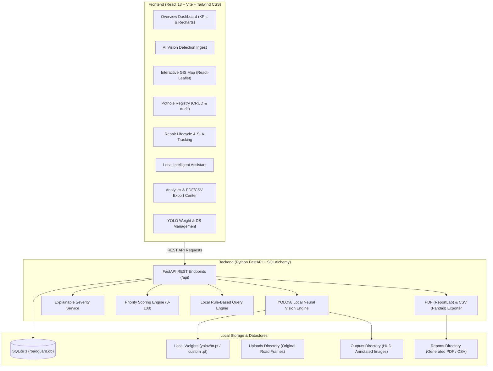
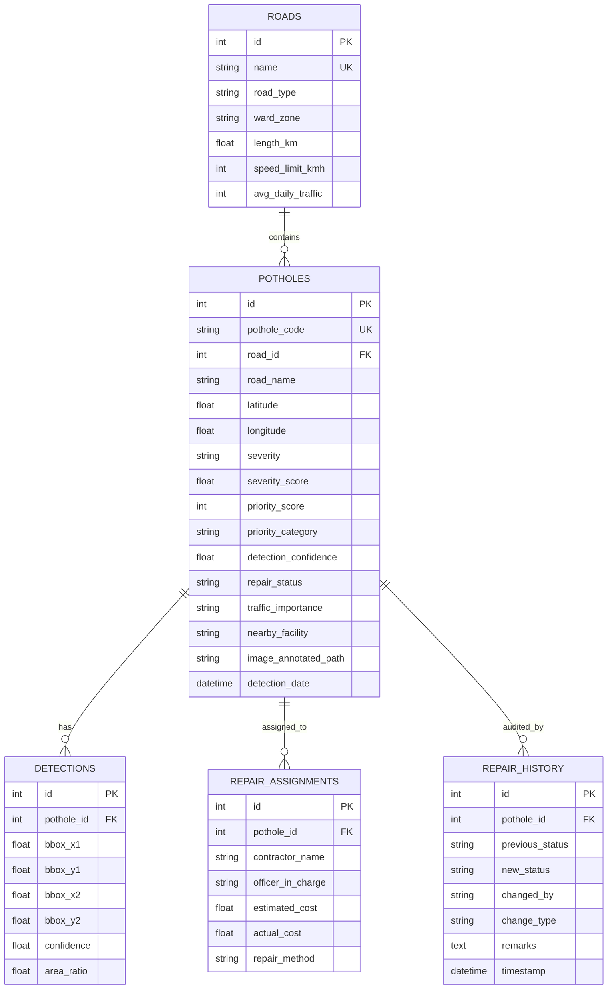

# RoadGuard AI — Intelligent Road Condition Monitoring System
### Final-Year B.Tech Artificial Intelligence and Data Science Capstone Project


---

## 1. Executive Summary & Objective

**RoadGuard AI** is an end-to-end municipal road intelligence platform designed to automate road defect detection, evaluate pavement damage severity, prioritize maintenance interventions, and streamline field repair operations.

Unlike traditional commercial systems that rely on expensive proprietary cloud APIs (e.g., OpenAI, Google Maps, Gemini), RoadGuard AI runs **100% locally and offline**. It integrates:
- Real local neural inference via **Ultralytics YOLO** (running on local CPU or CUDA).
- Free global geospatial visualization powered by **React Leaflet and OpenStreetMap**.
- Transparent mathematical severity classification and priority scoring.
- Live database-driven decision support via a local rule-based AI Maintenance Assistant.
- Official municipal PDF audit report generation using **ReportLab** and CSV data export using **Pandas**.

---

## 2. System Architecture



---

## 3. Technology Stack

### Frontend:
- **Framework**: React 18.3.1 with Vite 6
- **Styling**: Tailwind CSS (Dark Navy Municipal Smart-City Theme)
- **Icons**: Lucide React
- **Data Visualization**: Recharts (Donut charts, Area charts, Bar charts)
- **Geographic Information System (GIS)**: Leaflet 1.9.4 & React-Leaflet 4.2.1
- **Tile Provider**: OpenStreetMap (Free, zero API key requirement)
- **Routing**: React Router v6

### Backend:
- **Framework**: FastAPI with Uvicorn ASGI Server
- **ORM & Database**: SQLAlchemy 2.0 with SQLite 3
- **Validation**: Pydantic v2
- **Image Processing**: OpenCV (cv2), Pillow (PIL), NumPy
- **Deep Learning / Vision**: Ultralytics YOLOv8, PyTorch
- **Report Generation**: ReportLab (Municipal PDF document layout) & Pandas (CSV export)

---

## 4. Required Modules & Capabilities

### Module 1: Dashboard
- **Live KPIs**: Total Defects Detected, Critical Potholes, High-Priority Potholes, Medium/Low Priority, Repaired Defect Count, Active Maintenance Backlog, Monitored Corridors Count, City Pavement Health Index (0-100% circular gauge).
- **Analytical Charts**:
  - Pothole Severity Donut Chart.
  - Weekly Detection Trend Area Chart.
  - Maintenance Priority Distribution Bar Chart.
  - Operational Repair Pipeline Bar Chart.
- **Surveillance Log Table**: Showing recent defects, coordinates, priority badges, and quick audit access.

### Module 2: AI Pothole Detection & Vision Metrology
- Ingests JPG, JPEG, PNG, and WEBP road frames via file selector or drag-and-drop.
- Built-in synthetic sample road generators:
  - `Severe Defect` (large jagged cavity on asphalt).
  - `Medium Pothole` (moderate road fissure).
  - `Clean Road Surface` (smooth asphalt verifying that 0 false positives are stored).
- Executes local neural forward pass with real latency metrology (typically 50-180 ms).
- Renders HUD-grade visual annotations with bounding boxes, confidence badges, severity levels, and corner brackets.
- Persists verified hazards to SQLite with road name, coordinates, traffic density, and nearby facilities.

### Module 3: Transparent Severity Classification
Severity is determined using an explainable mathematical formula:
$$\text{Base Score} = f(\text{Area Ratio}) + (\text{Confidence} \times 25) + \text{Traffic Factor} + \text{Facility Factor}$$
- **Area Ratio**: Optical 2D surface coverage relative to camera frame.
  - Massive ($\ge 8\%$): 45 points base
  - Large ($4\% - 8\%$): 35 points base
  - Medium ($1.5\% - 4\%$): 25 points base
  - Minor ($< 1.5\%$): 15 points base
- **Confidence Factor**: Model confidence weight ($\max 25$ points).
- **Traffic Factor**: Critical ($+20$), High ($+15$), Medium ($+10$), Low ($+5$).
- **Facility Factor**: High risk ($+10$), Medium ($+6$), Low ($+3$), None ($0$).
- **Final Classification**:
  - **Critical**: $\text{Score} \ge 75$
  - **High**: $55 \le \text{Score} < 75$
  - **Medium**: $35 \le \text{Score} < 55$
  - **Low**: $\text{Score} < 35$

> **Scientific Disclaimer**: 2D optical bounding-box area calculations represent surface visual defect coverage in camera perspective. They do not constitute absolute physical volumetric cavity depth.

### Module 4: Priority Management & Authority Override
Calculates an explainable 0–100 priority index:
- **Base Severity**: Critical (+40), High (+30), Medium (+20), Low (+10)
- **Traffic Density**: Critical (+30), High (+20), Medium (+10), Low (+5)
- **Facility Proximity**: Hospital (+20), School (+15), Transit Hub (+12), Market (+8), None (+0)
- **Historical Defect Cluster**: Recurrent defect on same corridor (+10)
- **Confidence Bonus**: High confidence verification (+5 if $\ge 85\%$)
- **Action Directives**: Dynamically generates municipal response orders (e.g. "Deploy rapid response repair crew within 12-24 hours").
- **Authority Override**: Allows authorized engineers to override priority scores with mandatory logged audit justifications.

### Module 5: Interactive GIS Map
- High-performance React Leaflet map with dark theme styling.
- Pins color-coded by defect severity and repair status:
  - Red: Critical Pothole
  - Orange: High Severity
  - Amber: Medium Severity
  - Emerald: Low Severity
  - Blue: Repaired / Verified Patch
- Filter toolbar by severity, repair stage, and road name search.
- Interactive popups showing defect code, road name, coordinates, priority score, thumbnail preview, and full record modal launcher.
- Manual coordinate input drawer for locating defects when GPS telemetry is unavailable.

### Module 6: Pothole Management
- Comprehensive management table featuring Pothole ID, Road Name, Severity, Priority Score, Model Confidence, Coordinates, Detection Date, Repair Status, and Actions.
- Real-time search, multi-column filters, sorting (date, priority, severity), and pagination.
- Modal dialogs for viewing full photographic evidence, editing metadata, updating lifecycle status, and safe deletion confirmation.

### Module 7: Repair Operations & SLA Tracking
- Implements the complete 6-stage municipal civil engineering repair lifecycle:
  1. `Detected` — Initial AI computer vision capture.
  2. `Reported` — Scout / citizen verified.
  3. `Assigned` — Dispatched to contractor work order.
  4. `In Progress` — Surface milling and compaction underway.
  5. `Repaired` — Asphalt patching complete.
  6. `Verified` — Certified by civil engineer for surface smoothness compliance.
- Form inputs for assigning contractor, supervising engineer, scheduled dates, repair costs, asphalt specifications, and before/after verification photos.
- Immutable audit trail stored in `repair_history`.

### Module 8: Local AI Assistant
- Local rule-based & pattern-matching engineering assistant running directly against SQLite.
- Fully offline without reliance on OpenAI, Gemini, or any paid cloud service.
- Answers queries such as:
  - *"How many potholes are critical?"*
  - *"Which road needs immediate repair?"*
  - *"How many potholes were repaired?"*
  - *"Which locations have the highest priority near schools or hospitals?"*
  - *"Show pending repairs"*
  - *"Summarize road conditions across the city"*
- Outputs structured responses with metrics tables and actionable engineering recommendations.

### Module 9: Analytics & Reporting
- Cross-sectional corridor analysis comparing defect densities and repair SLAs.
- Public facility risk analysis (hospitals vs schools vs transit hubs).
- **Export CSV**: Instant export of complete defect registry with dates and coordinates.
- **Export PDF**: Official municipal report generated via ReportLab with executive summary, defect register table, and civil engineering sign-off blocks.

### Module 10: Settings & Administration
- Model settings showing active weights, disk size, inference hardware (CPU/CUDA), and IoU thresholds.
- Custom `.pt` model weights upload functionality.
- Database backup (`roadguard.db` direct download).
- One-click demo data seeder (populating 15+ realistic urban road defects across realistic coordinates).
- System health diagnostics (Python, PyTorch, YOLO, OpenCV, free storage).

---

## 5. Database Architecture

SQLite Database File: `database/roadguard.db`



---

## 6. Windows Installation and Running Instructions

### Prerequisites
- Windows 10 or Windows 11 (64-bit)
- Python 3.10+ (Python 3.12, 3.13, or 3.14)
- Node.js v18+ & npm
- VS Code

---

### Step 1: Open Project in VS Code
Open your terminal in `C:\Ravi\Project` (or project root directory):

```powershell
cd C:\Ravi\Project
```

---

### Step 2: Start Backend Server (Terminal 1)

1. Open a PowerShell or Command Prompt terminal:
```powershell
# Optional: Create and activate virtual environment
python -m venv .venv
.venv\Scripts\activate

# Install backend dependencies (all pre-satisfied or installable)
pip install -r backend/requirements.txt

# Start FastAPI server on 127.0.0.1:8000
python -m uvicorn backend.app.main:app --reload --host 127.0.0.1 --port 8000
```

> **Convenience Batch Script**: You can alternatively double-click `run_backend.bat` in Windows Explorer!

Backend will be live at:
- **API Server**: [http://127.0.0.1:8000](http://127.0.0.1:8000)
- **Interactive Swagger Documentation**: [http://127.0.0.1:8000/docs](http://127.0.0.1:8000/docs)
- **Health Diagnostics**: [http://127.0.0.1:8000/api/health](http://127.0.0.1:8000/api/health)

---

### Step 3: Start Frontend Dev Server (Terminal 2)

1. Open a **second** terminal window:
```powershell
cd C:\Ravi\Project\frontend

# Install frontend dependencies (if not already installed)
npm install

# Start Vite development server
npm run dev
```

> **PowerShell Script Policy Notice**: If PowerShell blocks `npm run dev`, use:
> ```powershell
> npm.cmd run dev
> ```
> Or double-click `run_frontend.bat`!

Frontend will be live at:
- **Application UI**: [http://localhost:5173](http://localhost:5173)

---

### One-Click Launch (Both Servers)
Double-click `run_all.bat` in the project root to automatically open both backend and frontend in separate command windows!

---

## 7. Verification & Automated Test Suite

RoadGuard AI includes an automated backend test suite covering API contracts, database operations, mathematical calculations, and local neural inference:

To run tests:
```powershell
python -m pytest tests/test_backend.py -v
```

### Test Suite Results:
```text
============================= test session starts =============================
platform win32 -- Python 3.14.4, pytest-9.1.1, pluggy-1.6.0
collected 9 items

tests/test_backend.py::test_health_endpoint PASSED                       [ 11%]
tests/test_backend.py::test_dashboard_stats PASSED                       [ 22%]
tests/test_backend.py::test_potholes_list_and_filter PASSED              [ 33%]
tests/test_backend.py::test_map_locations PASSED                         [ 44%]
tests/test_backend.py::test_analytics PASSED                             [ 55%]
tests/test_backend.py::test_assistant_query PASSED                       [ 66%]
tests/test_backend.py::test_severity_and_priority_calculation PASSED     [ 77%]
tests/test_backend.py::test_image_detection_synthetic PASSED             [ 88%]
tests/test_backend.py::test_report_export PASSED                         [100%]

======================= 9 passed in 10.38s ========================
```

---

## 8. Summary of Completed Features

| Module | Feature | Status |
| :--- | :--- | :---: |
| **Module 1: Dashboard** | Live SQLite KPIs, Severity Donut, Weekly Area Chart, Health Index | Verified |
| **Module 2: AI Detection** | Local YOLOv8 inference, HUD bounding boxes, latency timing | Verified |
| **Module 3: Severity** | Explainable formula based on 2D area ratio, confidence & traffic | Verified |
| **Module 4: Priority** | 0-100 scoring engine, municipal action directives, authority override | Verified |
| **Module 5: GIS Map** | React-Leaflet + OSM, severity colored pins, popups, manual coord tool | Verified |
| **Module 6: Pothole Management** | Search, filter, multi-column sort, pagination, detail modal, edit, delete | Verified |
| **Module 7: Repair Operations** | 6-stage lifecycle (Detected $\rightarrow$ Verified), contractor SLA, audit logs | Verified |
| **Module 8: Local AI Assistant** | 100% offline rule-based natural language query engine on SQLite | Verified |
| **Module 9: Analytics & Reports** | Cross-corridor analytics, ReportLab PDF generation, Pandas CSV export | Verified |
| **Module 10: Settings & Admin** | YOLO weight upload, model status, database backup & demo data seeder | Verified |

---

## 9. Academic Project Certification
- **Project Name**: RoadGuard AI — Intelligent Road Condition Monitoring System
- **Domain**: Artificial Intelligence, Computer Vision, Geographic Information Systems (GIS), Municipal Engineering Automation
- **Target Audience**: Smart City Municipal Authorities, Highway Infrastructure Engineers, Civil Works Departments

